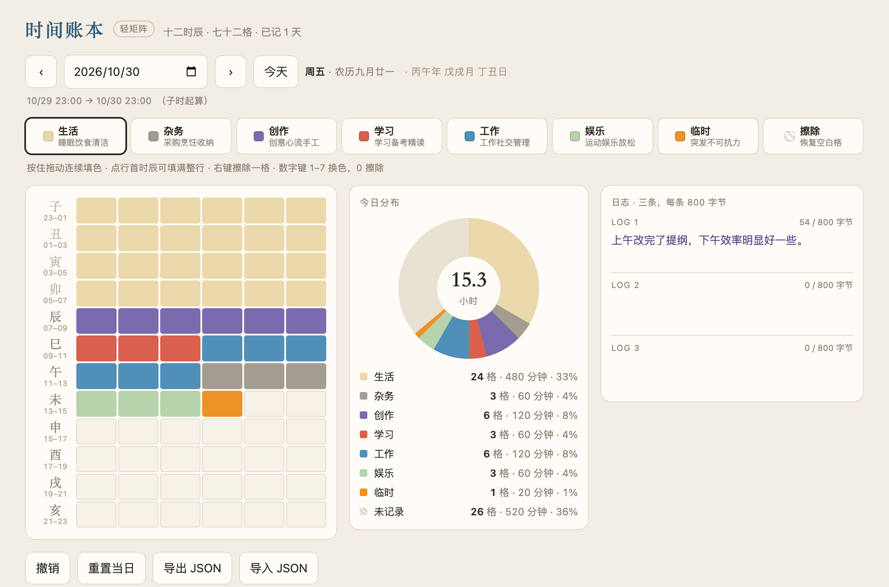

# 时间账本 · Time Ledger

一天 72 格，一格 20 分钟。像柳比歇夫那样，把时间花在哪里记清楚。
核心是一个 HTML 文件，无依赖、无构建，数据只存在你的浏览器里。

72 blocks of 20 minutes per day — a minimal ledger of where your time goes, after Lyubishchev.
One HTML file at its core — no dependencies, no build step. Your data never leaves your browser.



## 上手 · Getting started

1. 打开 `index.html`，按住拖动给时间段涂色
2. 点行首的时辰字，一次填满整行（2 小时）
3. 每天最多三条日志，输入后自动保存

1. Open `index.html` and drag across the grid to paint time blocks.
2. Click a 时辰 label on the left to fill a whole 2-hour row.
3. Up to three journal entries per day; they save automatically.

快捷键 · Shortcuts：`1`–`7` 换色 · `0` 擦除 · `⌘Z` 撤销

## 安装到手机 · Install on your phone

发布到 GitHub Pages 后，用手机打开网址：

- **iPhone**：Safari → 分享 → 添加到主屏幕
- **Android**：Chrome → 菜单 → 安装应用

装好后是独立窗口，没有地址栏；首次打开需要联网，之后离线可用。

> 删除主屏图标会连同本地记录一起清掉，删之前先「导出 JSON」。

After the repo is on GitHub Pages, open the URL on your phone:

- **iPhone**: Safari → Share → Add to Home Screen
- **Android**: Chrome → menu → Install app

It runs in its own window with no address bar. The first load needs a network;
after that it works offline.

> Removing the icon also deletes the stored data — export your JSON first.

## 七类 · Categories

| 类别 | 包含 | Category |
|---|---|---|
| 生活 | 睡眠、饮食、个人清洁 | Life |
| 杂务 | 采购、烹饪、整理收纳 | Chores |
| 创作 | 写作、手工、创意、冥想 | Create |
| 学习 | 学习、备考、精读 | Study |
| 工作 | 工作、社交、管理 | Work |
| 娱乐 | 运动、娱乐、放松 | Play |
| 临时 | 突发、不可抗力 | Ad hoc |

记账日从 23:00 起算（子时），深夜那两个小时计在前一天。
The day starts at 23:00 (子时, the first 时辰), so late-night hours count toward the previous day.

## 数据 · Data

存在浏览器的 localStorage（键 `lightmatrix.v1`），不上传、不同步。
换设备请用「导出 JSON」搬迁。

Stored in your browser's localStorage under `lightmatrix.v1`. Nothing is uploaded.
Use Export JSON to move it to another device.

## 已知限制 · Limits

- 法定节假日表只覆盖 2026 年
- 节气交节时刻误差 0–12 分钟
- 20 分钟粒度，每个边界有 ±10 分钟误差

- The public holiday table covers 2026 only.
- Solar terms are accurate to about 12 minutes.
- 20-minute granularity means ±10 minutes per boundary.

## 零点版 · Zero-hour variant

`variants/zero-hour.html` 从 00:00 起算，默认休息 00:00–06:00。日界不同，存档互不相通。

`variants/zero-hour.html` starts the day at 00:00, with 00:00–06:00 as default rest.
Different day boundary, separate storage.

## 本地运行 · Run locally

双击 `index.html` 即可。也可以起一个本地服务：

```bash
python3 -m http.server 8000
```

## 出处 · Credit

灵感来自苏联生物学家、数学家柳比歇夫（Александр Любищев, 1890–1972），
以及格拉宁写他的《奇特的一生》。

Inspired by the Soviet biologist and mathematician Alexander Lyubishchev
(А. А. Любищев, 1890–1972), and Daniil Granin's book about him, *This Strange Life*.

## 许可 · License

未指定 · Not specified.
